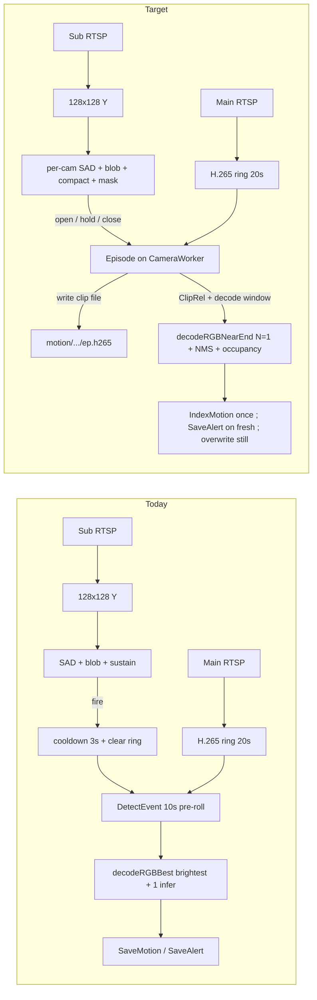
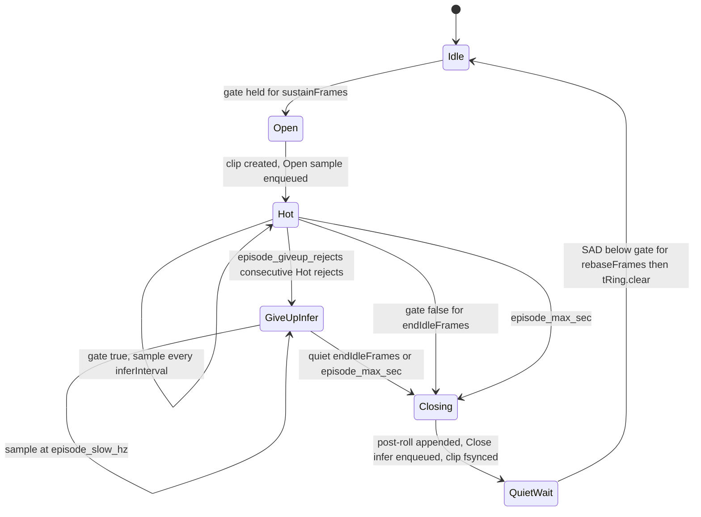
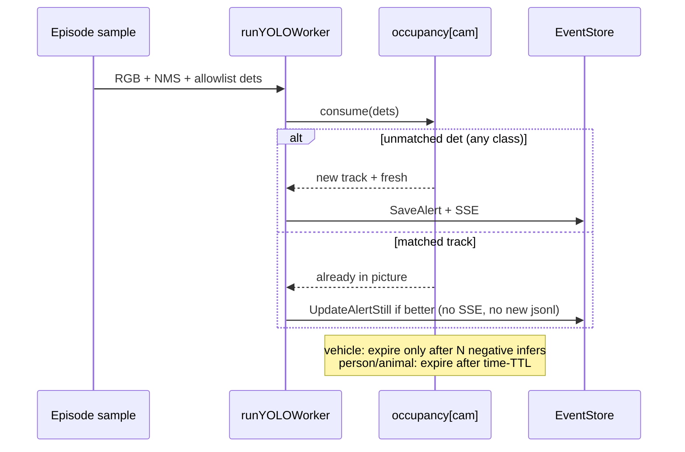

# Production motioncamotion: motion, multi-frame YOLO, animals, occupancy

| Field | Value |
|-------|--------|
| **Author** | TBD |
| **Date** | 2026-08-14 |
| **Status** | Draft (rev 3) |
| **Repo** | `/home/karman/motioncamotion` |
| **Production binary** | `./motioncamotion cameras_all.json` |
| **Audience** | Engineers who already know this tree |

---

## Overview

The live `motioncamotion` process has been stable ~32 days (since 2026-07-13) on 11 cameras at ~6.4% CPU / ~760 MB. That is the right architecture: sub-stream thumbs for motion, compressed main H.265 ring, one serial OpenVINO worker, event-driven infer. It is **not** ready to replace Frigate as a product.

Today the motion gate and the capture policy are the same knob (`threshold` + 3s cooldown + thumb-ring clear). Distant people on hik2 sit in the same 3–5% SAD band as IR trees on cam118. After fire, `sub_stream.go` clears the thumb ring and `tryMotionFire` enforces a 3s cooldown, so a walk-through becomes **one** main-ring snapshot. `decodeRGBBest` then picks the **brightest** frame in that 10s **pre-roll**, not the motion frame, and `ov_infer_run_multi` returns 10–19 un-NMS'd copies of the same person. Classes are hardcoded to person/car/cat. There is no occupancy, so a parked bakkie (often COCO `truck`) would re-alert every episode. The web list only sees the last 100 of 200 RAM index lines.

This design keeps the existing Go + VPL + OpenVINO binary and the existing receive/decode/TUI. It replaces cooldown-as-capture with an **active episode**, tightens the motion gate per camera (threshold, compactness, masks), infers **near-end frames** (Open + 2 Hz Hot + once on Close) with **NMS**, alerts on **new** objects only (RAM occupancy: vehicles expire only on negative observation), expands the class set to **COCO people + cars + truck/bus + animals** behind a per-cam allowlist, and pages `events.jsonl` in the Safari UI.

ffmpeg remux-to-H.264-MP4 is already removed in the working tree (`remuxClipToMP4` deleted from `store.go`). New events write `.h265` + JPEG only. This document does **not** add a muxer.

---

## Background & Motivation

### What the product is

A custom Go NVR/detect stack meant to replace Frigate because Frigate is too heavy. Production path (do not rewrite):

```
Sub RTSP  → VPL decode → 128×128 Y thumb → temporal SAD + blob + sustain + cooldown → DetectEvent
Main RTSP → compressed H.265 AU ring (snapshotDur=10s / ringKeepDur=20s)
detectQ   → single YOLO worker → decodeRGBBest → OpenVINO YOLOv8n → alert if person/car/cat
Media     → media/motion/YYYYMMDD/*.h265 + .jpg ; media/alerts/YYYYMMDD/*.jpg + .json ; events.jsonl
Web       → :8088  (Safari: still + .h265 download, no <video>)
```

Platform rules live in `docs/UNIVERSAL_CORE.md` and `AGENTS.md`: no ffmpeg/go2rtc in the app, libraries, `cmd/*` harnesses, or runtime helpers; production decode is the project VPL/Go stack only; looksee/motion/YOLO are features of `./motioncamotion`, not side scripts.

### Live evidence (snapshot 2026-08-14 ~22:00, `cameras_all.json`)

Counts below are a **point-in-time snapshot** of `media/events.jsonl` after prune. The file grows while the process runs (review-time re-read: 497 lines / 459 motion / 38 alerts). Structural claims do not depend on the exact totals.

Global gate (after `loadConfig` defaults): `threshold` 0.03 (3% SAD), `motion_sustain_frames` 3, `motion_cooldown_sec` 3, `motion_min_blob` 8, `motion_avg_frames` 3, `motion_lag_frames` 8, `main_conf` 0.65, `sub_conf` 0.5, `force_stage2` true. Stage-1 sub RGB is never passed (`enqueueDetect(..., nil)` in `sub_stream.go`). Existing `motion_masks` are OSD corners only (≈0.28×0.06 at the top), not foliage.

Snapshot totals: **484 lines — 447 motion, 37 alerts**.

| Camera | Motion | Alerts | Notes |
|--------|--------|--------|--------|
| hik1 | 110 (user: 61 today) | 34 (user: 21) | Yard people; works when close |
| hik2 | 6 | 3 | Alert SAD **4.15, 3.38, 3.27**. **09:41 motion SAD 3.25, still shows person by truck, YOLO rejected** |
| cam118 | 228 | 0 | IR trees. Inter-fire gap p50=4.39s; **137/227 gaps in [2.5, 5]s** = cooldown pump |
| cam57 | 74 | 0 | Noise |
| hik51_1 ("River 1") | 12 | 0 | SAD 3.57–99.37% (wind / leaves) |
| hik3 | 0 | 0 | Quiet all day |
| hik1 16:16 | 1 motion | 0 | Still looked cat-like; **user watched clip — no cat**. Bags/foliage. Not a detect miss |

Fired SAD (snapshot): min 3.00, p50 4.15, p90 6.80, max 99.37. The 3% gate is the binding constraint. Real distant people and tree noise occupy the same 3–5% band.

Alert box counts (37 alerts): min 3, p50 **10**, p90 16, max **19**. hik1 09:03:46 has 19 `person` rows that are two real people duplicated (clusters at x≈138 and x≈330). Confirms `ov_infer_run_multi` has no NMS.

hik2 09:41 record (`hik2_20260814_094124_434378`): motion-only, `sad=3.252…`, still on disk, no alert line. Smoking-gun miss: the person is in the JPEG; `main_conf=0.65` + single frame + brightest-frame pick rejected it. Do **not** cite hik1 16:16 as a YOLO miss.

### Known code problems (verified)

1. **`decodeRGBBest` (`decoder.go:47–77`)** walks every AU in the 10s pre-roll and keeps the **highest `rgbMean`**. The motion instant is the **tail** of that slice, not the brightest GOP. Then `runYOLOWorker` infers **once**.

2. **After fire (`sub_stream.go:312–319`)** `enqueueDetect("motion", sad, nil)` then **`tRing.clear()` + `streak = 0`**. Combined with `tryMotionFire` (`worker.go:84–94`) and default `motion_cooldown_sec=3`, a walk-through is one snapshot. User: 3s cooldown is way too much — a single frame of the person, can miss the face.

3. **`ov_infer_run_multi` (`ov_infer.c:347–442`)** collects every wanted-class pred ≥ conf, insertion-sorts by score, truncates to `OV_MAX_DETS` (32). **No NMS.** `class_wanted` is `cls == 0 \|\| cls == 2 \|\| cls == 15`.

4. **`cocoNames` (`yolo_worker.go:25–29`)** only 0/2/15. User wants people + cars + **all animals**, and the driveway bakkie must be visible to occupancy as `car` **or** `truck` (COCO often labels pickups as 7).

5. **No occupancy.** Every `mainPass` calls `SaveAlert`. A parked bakkie that re-triggers motion re-alerts.

6. **One global threshold.** Noisy cams flood `detectQ` (buf 64, `main.go:205`) and evict the UI list (`EventStore.recentN=200`). `/api/events` **hardcodes** `limit := 100` and does **not** read a `limit` query param (`web.go:66–68`).

7. **Snapshot is 10s before trigger only** (`snapshotDur` in `worker.go:21`). `ring.snapshot` copies AUs with `at >= now-10s`. No post-trigger recording while the person walks in. Ring keep is 20s (`ringKeepDur`) but nothing consumes the post-roll.

8. **Web list cannot page** older events that are still on disk. `List` only walks `s.recent`.

`docs/MOTION_DESIGN.md` already told us to clear the thumb ring after fire so the lag window does not stay hot and re-fire every cooldown on outdoor IR. That was the right fix **when cooldown was the capture policy**. It is the wrong fix once we want an episode.

---

## Goals & Non-Goals

### Goals

1. Motion that catches hik2-class distant/slow people and does not flood on cam118 / River 1 foliage.
2. YOLO that detects **people, cars, truck/bus, and the COCO animal set**, with **NMS**, on **several frames per episode** near the motion instant (enough to catch a face).
3. **Occupancy:** alert on **new** objects entering the picture; do not re-alert a vehicle that was already there (expire vehicles only when infer ran and they were gone); a person/animal who leaves and comes back later **does** alert again.
4. **Stop using 3s cooldown as the capture policy.** Resolve “more frames vs no repeat alerts” with an **active episode + occupancy**, not a long silence.
5. Stay on the existing Go + VPL + OpenVINO binary. Incremental PRs. Validate on hik1/hik2 before declaring Frigate-replaceable.
6. Safari UI: still + `.h265` download. Page retained `events.jsonl`. No `<video>` tag in this work.

### Non-goals

- Rewrite RTSP receive, VPL decode, thumb size, TUI, or looksee.
- MOG2 / full background model.
- Continuous 15 fps YOLO on all cams, or main-stream always-on infer.
- ffmpeg, go2rtc, or any remux/transcode in the product path.
- HEVC-in-MP4 mux for Safari `<video>` (user just removed mp4; later optional PR).
- MQTT / Home Assistant notify (Frigate-replacement *may* want this later; not demanded; later optional PR).
- Wildlife-specific detector (MegaDetector etc.) unless COCO animals fail on a scoped cam.
- Persisting occupancy across process restart.
- Changing `EventRecord.VideoRel` semantics; it stays for old index lines / prune.
- Re-adding `remuxClipToMP4`.
- Enabling `bird` (or other wildlife classes) on cam118 / hik51_1 until Open Question 2 is answered.

---

## Key Decisions

1. **Keep the architecture; change policy.** Sub thumbs → gate → episode → serial YOLO on main-ring AUs. No second detect path, no main-stream always-on YOLO.

2. **Episode replaces cooldown as the capture policy.** While the gate stays hot, keep sampling. After the scene quiets, rebase the thumb ring. A short re-arm (`episode_rearm_ms`, default 300) is only anti-chatter, not the face-capture mechanism. `motion_cooldown_sec` stays a **separate** inter-episode silence knob; do not overload it.

3. **Motion improvements are config + small gate math**, not a new engine. Per-cam `threshold` / `min_blob` / **compactness** (`maxBlob / nChanged`) / extra `motion_masks`. `motionScoreTemporal` must return `nChanged` (or compact). Adaptive noise floor is a follow-on if hik2 vs cam118 cannot be split by per-cam config.

4. **Infer stays event/episode-driven on one serial worker.** Multi-frame means Open + 2 Hz Hot + one Close infer **per episode**, not 15 fps. Foliage must not hold a 2 Hz infer loop: compactness + Hot-only give-up + `require_quiet_to_rearm` + `episode_max_sec`.

5. **Frame pick: tail of the snapshot, not brightest.** Replace `decodeRGBBest` with `decodeRGBNearEnd(..., 1)`. Open is **N=1**. Face diversity comes from Hot 2 Hz + Close, not three consecutive tail pictures. AU slices start at the last IRAP **at or before** the picture-window cutoff.

6. **NMS in `ov_infer_run_multi`** (class-aware greedy IoU). Required. Production path is `ov_infer.c` used by `yolo_worker.go`.

7. **C wanted set = person + car + truck + bus + COCO animals.** Driveway bakkie is often COCO `truck` (7); occupancy cannot see it if 7 is filtered. **Go default allowlist from PR 5 is `person, car, cat, truck, bus`** (no animals). Do not enable `bird` on cam118 / hik51_1 until Open Question 2. PR 8 adds animals on hik1/hik2 only.

8. **Occupancy = RAM tracks, not wall-clock “we didn’t look.”** Vehicles (`car`/`truck`/`bus`) expire only on **negative observation** (this camera ran infer and the box was absent for N samples). People/animals keep a time-TTL so leave-and-return re-alerts. Lost after restart (first vehicle alert after reboot is accepted). No cloud tracker.

9. **Association is class-split.** Vehicles: strict IoU ≥ 0.40. People/animals: IoU ≥ 0.40 **or** centroid inside the previous box expanded by `min(0.5×box, occupancy_expand_px)` (default **48 px** on 640). Episode-scoped: a matched track never `SaveAlert`s again.

10. **One motion clip owned by `CameraWorker`.** Create the `.h265` on Open, append while Hot, fsync on Close. Detect samples carry `ClipRel` + a **decode window**, not the accumulating bitstream. YOLO worker indexes motion once; it never rewrites the clip.

11. **Notify once per fresh object; overwrite the still.** First fresh → `SaveAlert` + SSE. Later better frame → overwrite the same JPEG / sidecar; no second jsonl line, no second SSE. A **new unmatched person/animal** later in the same episode is a second object → second `SaveAlert` + SSE.

12. **UI pages `events.jsonl`.** `recentN=200` stays as the SSE/RAM cache only. `ListPage` shares the store lock with prune; SSE **appends** rows and does not replace a “Load older” list.

13. **No muxer in this program of work.** Safari keeps JPEG + `.h265` download.

14. **Validate hik1 + hik2 first**, then roll config to the noisy cams. Do not flip all 11 cams’ thresholds or class allowlists in one PR.

15. **Occupancy lands before episode sampling.** `main_conf` 0.65→0.45 is a **later** config PR after hik2 walks, not bundled with the first occupancy merge. A per-episode alert cap is **only** a fallback when occupancy is off or not wired — never AND-ed with occupancy.

16. **`workerOpts` lands in the compactness PR**, not a second constructor churn in the episode PR. Per-cam inherit uses pointers / `-1`, not “0 means inherit.”

---

## Proposed Design

### Pipeline (current vs target)



### 1. Motion gate (keep `motionScoreTemporal`, add compactness + per-cam)

Do **not** replace `sadMotion` / `maxBlob`. Compactness needs an API change: `sadMotion` already has `nChanged` internally, but `motionScoreTemporal` (`thumb_ring.go:81–102`) returns only `(sad, blob, ready)`. `sub_stream.go:308` cannot compute `blob/nChanged` without a rounding hack through `sad/100*active`.

```go
// motion.go — next to maxBlob
func compactness(blob, nChanged int) float64 {
    if nChanged <= 0 {
        return 0
    }
    return float64(blob) / float64(nChanged)
}

// thumb_ring.go
func motionScoreTemporal(...) (sad float64, blob, nChanged int, ready bool)
```

`nChanged` is the count of `changed[i]==true` already produced by `sadMotion`. Compactness:

```
compact = 0 if nChanged==0 else float64(blob)/float64(nChanged)
// Person-sized mover: one blob, compact typically 0.3–1.0
// IR leaf shimmer: many small components, compact low
// Whole-canopy sway: one huge blob, compact high → needs a mask, not compactness alone
```

Fire condition in `sub_stream.go` today:

```go
if sad >= w.sadCutoff && blob >= w.minBlob {
    // streak / tryMotionFire / enqueue / tRing.clear()
}
```

Target fire-to-**open-or-hold-episode** condition:

```go
if sad >= w.sadCutoff && blob >= w.minBlob && compact >= w.minCompact {
    // episode machine — see below
}
```

`minCompact` default **0** keeps today’s behavior for cams we have not tuned. hik2 stays near 3% with a low compactness floor (distant person is a small blob; compactness can still be high because `nChanged` is also small). cam118 / hik51_1 get a higher `threshold` **and** `min_compact` **and**, after a measured looksee walk, foliage rects in `motion_masks`.

Optional follow-on (not in the first motion PR unless hik2 vs cam118 still collide): per-cam **adaptive floor** = `max(threshold, ema_quiet_sad + k*sigma)` updated only when **not** in an episode. **Do not ship this on hik2 first** — the smoking-gun miss is 0.25% above the hard floor. Adaptive will hide hik2 people if trained on the same 3–4% IR noise they occupy.

Per-cam overrides live on `Camera` (currently `Name`, `Main`, `Sub`, `MotionMasks` only — `main.go:51–56`). Global keys remain the default. Inherit uses pointers / `-1` (see §8); **0 is a real zero** (e.g. `min_compact=0` on hik3 while global is 0.35).

Suggested starting values after hik1/hik2 walk-throughs (tune on the real binary, do not guess into production). **PR 3 ships code with global `min_compact=0` (no behavior change).** PR 8 writes the numbers after walks. Foliage **rects are not authored in the first config drop** — raise `threshold` / `min_blob` / `min_compact` first; add masks only after the operator marks a looksee JPEG (see PR 8).

| Cam | `threshold` | `min_blob` | `min_compact` | Masks |
|-----|-------------|------------|---------------|--------|
| hik1 | 0.03 (keep) | 8 | 0.20 | existing OSD; optional bag/foliage strip from 16:16 **after** a measured still |
| hik2 | 0.028–0.030 | 6–8 | 0.15 | existing OSD only — do **not** raise this cam to kill cam118 |
| cam118 | 0.06–0.08 | 12 | 0.35 | tree / sky rectangles **after** looksee measure; threshold first |
| hik51_1 | 0.08+ until OQ2 | 16 | 0.40 | same: numbers first, canopy rects after measure |
| hik3 | keep global | 8 | 0 | quiet |

`pHash` in `motion.go` stays unused. Do not revive it.

### 2. Episode state machine (replaces cooldown-as-capture)

Cooldown today is `CameraWorker.lastMotionAt` + `w.cooldown` (`worker.go:84–94`). Default 3s is applied **before** enqueue, and the ring is cleared **after**. That is why walk-throughs are one still.



Rules:

- **Open:** first time `sad/blob/compact/sustain` pass and no episode is live. `CameraWorker` creates `media/motion/YYYYMMDD/{episodeID}.h265` and writes the 10s pre-roll (`buildClipBitstream(ring.snapshot(snapshotDur))`). Enqueue **one** Open sample: `ClipRel` + decode window = that pre-roll (already IDR-aligned via `buildClipBitstream` / last IRAP). **Do not clear the thumb ring. Do not start a 3s cooldown.**
- **Hot:** each subsequent thumb that still passes the gate **holds** the episode. Every `infer_interval` (default **500 ms**, 2 Hz; config `episode_infer_hz`) **append** `ring.snapshotSince(lastSnap)` to the clip file and enqueue a sample whose `Segments` are **only** `snapshotForDecode(now-2s)` (picture window 2s, AU slice starts at last IRAP ≤ cutoff). Do **not** send the accumulating clip on `detectQ`.
- **Give-up (Hot samples only):** after `episode_giveup_rejects` (default **3**) consecutive **Hot rejects**, drop to `episode_slow_hz` (default **0.2**). A Hot reject is `nAllowlistDets == 0` (boxes left **after the Go allowlist**). C-level `bird` (or any class the allowlist drops) does **not** reset the streak and does **not** hold 2 Hz. **Do not count Open’s single infer.** **Do not give up on Open alone.** Do **not** close immediately — stay in GiveUpInfer until quiet or `episode_max_sec`, so Close can still catch a face-on frame.
- **Close:** gate fails for `episode_end_idle_frames` (default = `lagFrames`, ~8 thumbs ≈ 0.8s @10 fps), or `episode_max_sec` (default **30s**) hits. Wait `episode_post_sec` (default **2**) after the gate drops so the person stopping to look is on the clip **and** in the Close decode window. Append remaining AUs, `fsync` the clip, enqueue **one Close sample** (`snapshotForDecode` on the post-roll tail). Then QuietWait.
- **Rebase:** after close, wait until SAD is **below** gate for a few thumbs, **then** `tRing.clear()` + `streak=0`. This is the MOTION_DESIGN.md IR-noise fix, moved to episode end instead of fire.
- **Re-arm:** `episode_rearm_ms` default **300**. Not 3000. Only prevents Open/Close chatter.
- **`require_quiet_to_rearm`:** config bool, default **true**. When true, after close-from-max **or** close-from-giveup, do not Open again until the gate has been false. After a normal quiet close, the short re-arm is enough. Stops cam118 from being one 30s episode after another.

`tryMotionFire` is replaced by `episodeTick(sad, blob, compact, now) (action, sample bool)`. Keep it on `CameraWorker` (already has `mu`, `lastMotionAt`, ring). New fields, same struct.

**YOLO → CameraWorker feedback (required for GiveUpInfer):** infer results live only in `runYOLOWorker`. There is no second detect path. After allowlist (and occupancy, which does not change the count), the YOLO worker calls one method on the existing struct:

```go
// CameraWorker — same mu as lastMotionAt. Ignores episodeID mismatch (stale sample).
func (w *CameraWorker) noteInferResult(episodeID string, nAllowlistDets int)

// runYOLOWorker holds the same []*CameraWorker main already has (or map by name).
// After Go allowlist filter, before or after consume (same len):
//   workers[ev.Cam].noteInferResult(ev.EpisodeID, len(allowlisted))
```

`episodeTick` reads `w.hotRejectStreak` under `mu`. If `nAllowlistDets == 0` and the live episode matches `episodeID` and the sample was Hot, increment; else if `nAllowlistDets > 0`, reset to 0. Open/Close results do not change the streak. A parked bakkie on the allowlist (`nAllowlistDets >= 1`) keeps 2 Hz — that is correct; give-up is for empty foliage, not occupied driveways.

**`episode_infer_hz = 0` (rollback / single-shot mode):** one Open sample, **no Hot samples**, then Close after `episode_post_sec` (Close still infers once). Clip is still pre + post. Rebase-on-quiet still runs. This is **not** the same as `motion_cooldown_sec=3`. Cooldown is a separate inter-episode silence; leave it at today’s meaning unless the operator sets `-1` (off). See §8.

Why this resolves the tension:

- More frames: Open N=1 + Hot at 2 Hz for the walk (typically 3–8s → 6–16 attempts) + **one Close infer** when they stop and look (SAD has often already dropped).
- No repeat alerts: occupancy (§6). Episode is **capture**; occupancy is **notify**.

### 3. Multi-frame decode + infer (kill brightest-frame)

`decodeRGBBest` is wrong for this product. The snapshot is **pre-trigger**; the person is at the **end**. Brightest-in-10s prefers headlights, sky, IR wash, an earlier empty yard.

Replace with a function that still uses `NewFrameDecoder(CodecHEVC)` and still feeds AUs in order from the last IRAP (VPL needs a keyframe):

```go
// decodeRGBNearEnd feeds segments in order, keeps the last n successfully
// decoded 640×640 RGB frames (closest to the snapshot tail).
// Production calls use n=1. Caller must pass an IRAP-prefixed AU list.
func decodeRGBNearEnd(segments [][]byte, outW, outH, n int) (frames [][]byte, decoded int, ok bool)
```

**Open is N=1.** Three consecutive successful `RGB()` results at 15–25 fps are ~120–200 ms apart — the same pose. They do not search for a face and they would trip a naive “3 rejects” give-up on hik2 09:41. Face diversity is Hot 2 Hz + Close, not Open×3.

Worker policy per **sample** event:

| Sample kind | Decode window | Infer |
|-------------|---------------|-------|
| Open | 10s pre-roll (already starts at IRAP via clip build) | **N=1** tail RGB |
| Hot (2 Hz or slowHz) | last ~2s **pictures**; AU slice from last IRAP **≤ cutoff** | **N=1** |
| Close | tail including `episode_post_sec` | **N=1** (always; this is the standing face-on shot) |

**IRAP walk-back (required):** `ring.snapshot` / `snapshotSince` are wall-clock cuts (`ring.go:51–67`). A 2s slice often starts mid-GOP and has **no** keyframe. `decodeRGBNearEnd` then returns `ok=false` and the face-on samples are wasted. Today’s 10s pre-roll almost always includes an IRAP; shrinking the window without walking back is a decode break.

```go
// ring.go — picture window [since, now], but bytes start at last IRAP at or before since.
// ringKeepDur is 20s, so the walk-back is in RAM.
func (r *ringBuffer) snapshotForDecode(pictureSince time.Time) [][]byte
```

IRAP test on **annex-B ring chunks** (not NAL lists): extend `segmentHasIDR` (today NAL **19–21** only, `hevc_clip.go:43–50`) or add `segmentHasIRAP` using the same types as live main inject (`h265AUHasIRAP`: NAL **16–21**, `sub_stream.go:38–49`). **Use 16–21** for decode windows. Clip concatenation may keep today’s 19–21 start if that is what `buildClipBitstream` already does; do not silently change clip start in the same PR as `snapshotForDecode` unless both call the 16–21 helper.

Best-still ranking (person-first), used when deciding whether to overwrite an alert JPEG:

1. Highest score among wanted classes on this cam’s allowlist.
2. Tie-break person boxes by area, then by aspect `h/w` (taller ≈ more face-like). **Not** a face model.
3. If this sample ranks higher than the JPEG already on disk for that alert, overwrite (see §6).

Do not infer 15 fps. Do not decode every AU in the 10s window just to pick brightness.

#### CPU math (11 cams, serial worker, ~400 ms/event today)

Measured historically (`docs/STATUS.md`): OpenVINO CPU infer ~170–195 ms, main decode of a 5s burst ~34–42 ms, full event ~400–420 ms. User’s current figure: **~400 ms/event**. Live process 6.4% CPU is **steady-state receive + sub thumbs**; infer is bursty.

Assume still-CPU infer = **180 ms/infer** and decode-to-one-RGB from last IRAP = **40 ms** → **~220 ms** per sample (Open, Hot, or Close). Open is no longer 3× infer.

| Scenario | Events / day (snapshot) | Infer policy | Worker wall time / day |
|----------|-------------------------|--------------|------------------------|
| Today, all cams | 447 motion × 400 ms | 1 brightest | **179 s** |
| hik1+hik2, Open+Close + 2 Hz for 5s | ~70 episodes × (0.22 + 8×0.22 + 0.22) ≈ 2.2 s | | **~154 s** |
| hik1 61 people-walks × 2.2 s | | | **134 s** |
| cam118 **if still 228 isolated fires** × Open+Close | 228 × 0.44 s | bad | **100 s** plus queueing |
| cam118 **after gate + episode max 30s + Hot give-up** | handful of foliage episodes × Open + 3 Hot + Close | | **seconds** |

11 cams, if **every** cam were hik1-busy (60 episodes/day × 2.2 s) = **1 452 s/day ≈ 1.7% of wall clock** on the serial worker. That is fine. The failure mode is **not** 11× hik1. It is **cam118-style foliage holding 2 Hz for minutes**.

Hard caps so that cannot happen:

- `episode_max_sec = 30`
- After **3 consecutive Hot rejects**: drop to 0.2 Hz until Close; `require_quiet_to_rearm` after that close
- Compactness/mask / higher threshold must make cam118 mostly never Open
- Skip Hot samples when `detectQ` is more than half full (never skip Open or Close)

`detectQ` stays `chan DetectEvent` buf 64. Samples carry a **decode window** (~2s + IRAP walk-back), not the full episode bitstream.

**Enqueue (replaces `enqueueDetect`’s fire-and-forget goroutine, `worker.go:388–395`):**

Open/Close **must not drop**. They **must not block** `OnPacketRTP` / `episodeTick` (today’s `go func(){ detectQ <- ev }` exists so a full `detectQ` cannot stall receive). Hot samples stay droppable.

```go
// CameraWorker: at most one send goroutine in flight (not one per tick).
// pendingOpen / pendingClose are 1-deep slots under w.mu.
func (w *CameraWorker) tryEnqueue(ev DetectEvent) {
    switch ev.Kind {
    case "sample":
        select {
        case w.detectQ <- ev:
        default:
            // log yolo backlog, sample dropped
        }
    case "open", "close":
        // store into the 1-deep pending slot (Close overwrites a prior unsent Close).
        // if no send goroutine is running, start exactly one: flushPending()
        // which blocking-sends pending Open then Close, then exits.
        // OnPacketRTP returns immediately.
    }
}
```

`flushPending` may block on `detectQ` — that is fine; it is not the RTP callback. A foliage storm cannot pile goroutines (cap = 1 per `CameraWorker`). If `len(detectQ) > 32`, skip scheduling new Hot samples and log `yolo backlog, sample dropped`. Serial worker remains correct; noisy cams degrade to “one clip, Open+Close infer”.

**`main_conf`:** stay at **0.65** until a dedicated config PR after hik2 walks (PR 8). Occupancy + NMS make a later drop to 0.45 cheap; flipping it in the first occupancy merge is how you get a flood on the live process.

### 4. Clip: `CameraWorker` owns the file

Today `enqueueDetect` snapshots 10s **before** `time.Now()` and `SaveMotion` writes a **new** id, a **new** `.h265`, and a **new** jsonl line (`store.go:172–213`). There is no update/append API. Close cannot “rewrite” via another `SaveMotion`. Mid-episode alerts must already have a `ClipRel` to download. Finalize must not wait behind YOLO backlog to create the file.

**Chosen ownership:**

| Who | Does |
|-----|------|
| `CameraWorker` | Creates `motion/YYYYMMDD/{episodeID}.h265` on Open (pre-roll). Appends `snapshotSince` AUs while Hot (raw annex-B, `stripParameterSets` on non-first chunks, same as `buildClipBitstream`). Appends post-roll on Close and `fsync`s. |
| Open/sample/close `DetectEvent` | Carries `ClipRel` + **decode window only**. Never the accumulating file. |
| YOLO worker | `IndexMotion` **once** on Open (jsonl + optional still after first decode). Never writes or rewrites the bitstream. Close does **not** emit a second motion line. |

```go
// store.go
func (s *EventStore) IndexMotion(rec EventRecord) error // append jsonl; file already on disk

// worker episode
ep.clipRel = "motion/"+day+"/"+ep.id+".h265"
writeFile(preRoll)           // Open
appendFile(snapshotSince)    // Hot ticks
appendFile(post); fsync()    // Close
```

`ringKeepDur` stays 20s. Do not grow it as the clip mechanism. The open file is the clip.

`VideoRel` remains unused on new writes. Alert rows point at the same `ClipRel`.

Episode id format: `{cam}_{yyyymmdd_hhmmss}_{nsec%1e6}` — same shape as today’s `SaveMotion` ids so paths stay familiar.

### 5. NMS + class set

`class_wanted` (`ov_infer.c:29–31`) expands to the **C-level** v1 set (model already emits all 80 COCO classes):

| id | name | Role |
|----|------|------|
| 0 | person | wanted |
| 2 | car | vehicle occupancy |
| 5 | bus | vehicle occupancy (cheap; same expire rule as car) |
| 7 | truck | **bakkie** — COCO often labels pickups as truck |
| 14 | bird | animal; **off** on cam118 / hik51_1 until OQ2 |
| 15 | cat | animal |
| 16 | dog | animal |
| 17 | horse | animal |
| 18 | sheep | animal |
| 19 | cow | animal |
| 20 | elephant | animal |
| 21 | bear | animal |
| 22 | zebra | animal |
| 23 | giraffe | animal |

`cocoNames` in `yolo_worker.go` must include the same ids. Unknown ids already render as `clsN`.

**Go allowlist (required):** after NMS, the worker drops classes not in `cam.classes`.

| When | Default allowlist |
|------|-------------------|
| PR 2 (C + names only) | still `person, car, cat` (0/2/15) — filter exists, truck/bus not enabled yet |
| **PR 5 onward** | **`person, car, cat, truck, bus` (0/2/15/7/5)** — occupancy can see a bakkie |
| PR 8 | hik1/hik2 add COCO animals; everyone else stays on the PR 5 default |
| Until OQ2 | cam118 / hik51_1: **no `bird`** |

C-level `bird` on foliage must not create alerts and must not reset the give-up streak (`nAllowlistDets` is post-allowlist).

NMS inside `ov_infer_run_multi` after the existing score sort, **before** copying into `out_dets`:

- Class-aware: only suppress same `class_id`.
- IoU ≥ **0.45** (standard greedy).
- Keep higher score.
- Still cap at `max_dets` / `OV_MAX_DETS`.

hik1 09:03:46 would become **2** person boxes, not 19.

`ov_infer_run` (single-best) does not need NMS. `ov_infer_class_scores` / `ov_infer_best_for_class` are only used by `cmd/frametest`; leave them unless a later PR touches that harness. Production is `runInferMulti` → `ov_infer_run_multi`.

C keeps the full v1 wanted mask so one compiled path serves all cams. Per-cam subset is Go-only. Optional later: pass a `uint64` mask into C; not required for v1.

Bicycle / motorcycle / boat stay **out** of v1 (Open Question 1 remainder).

### 6. Occupancy (RAM, per camera)

This is **not** “IoU + 600s wall-clock TTL for cars.” Infer only runs during episodes. A quiet driveway produces no samples, so `LastSeen` freezes; a 10-minute TTL would treat the bakkie as `fresh` on the next foliage episode. **“We did not look” is not “it left.”**



New file `occupancy.go` (pure Go, testable). One `map[string]*camOcc` on the YOLO worker (serial; no extra mutex if only the worker touches it).

```go
type occKind int

const (
    occVehicle occKind = iota // car, truck, bus
    occMover                  // person, animals
)

type occTrack struct {
    ClassID     int
    Kind        occKind
    Box         DetBox
    LastSeen    time.Time
    Misses      int    // consecutive infers on this cam with no match
    Alerted     bool
    AlertID     string // EventRecord.ID for still overwrite
    AlertRel    string // StillRel
    BestRank    float64
    EpisodeSeen string // last EpisodeID that matched
}

func (o *camOcc) consume(dets []DetBox, now time.Time, episodeID string) (fresh []DetBox) {
    // 1. match dets → tracks (same class; see association)
    // 2. unmatched dets: new tracks, append to fresh
    // 3. matched: update Box, LastSeen, Misses=0; not fresh
    // 4. unmatched tracks this infer:
    //    vehicle: Misses++; drop only if Misses >= vehicleGoneSamples (default 3)
    //    mover:   drop if now-LastSeen > lostTTL(class)
    //    never drop a vehicle solely because now-LastSeen is large
    return fresh
}

func associate(det DetBox, tr occTrack, expandPx float64) bool {
    if det.ClassID != tr.ClassID {
        return false
    }
    if iou(det, tr.Box) >= 0.40 {
        return true
    }
    // Movers only. Per-axis margin = min(0.5*boxDim, expandPx). Default expandPx=48
    // on 640 so a hik2 ~20×40 box that moves ~10 px still matches, and two
    // full-height people (~200×400, centers tens of px apart) do not fuse.
    if tr.Kind == occMover && centerInExpanded(det, tr.Box, expandPx) {
        return true
    }
    return false
}

func expandMargin(boxDim, expandPx float64) float64 {
    m := 0.5 * boxDim
    if m > expandPx {
        return expandPx
    }
    return m
}
```

| Class | Expire | Why |
|-------|--------|-----|
| car / truck / bus | **Negative observe only**: `vehicle_gone_samples` consecutive infers on this camera with no match (default **3**). No wall-clock TTL. | Parked bakkie stays occupied across hours of quiet and across foliage episodes. |
| person | Time-TTL **25s** since last match | Walk out and come back → new alert |
| other animals | Time-TTL **45s** | Left and returned should alert |

Restart: map is empty. First detect of a parked vehicle after reboot **will** alert once. Documented; no disk tracker.

**Episode-scoped dedup:** a matched track never produces `fresh`, including across Hot samples in the same episode. A walking hik2 person who fails IoU 0.40 still matches via capped expand and does not re-alert.

**Multi-object rule (closed — not an open question):**

1. First sample in an episode that has any `fresh` → **one** `SaveAlert` whose `Dets` are all `fresh` boxes from that sample. One SSE toast / `Notification`. Store `AlertID` / `StillRel` on those tracks.
2. Later sample, **same tracks** only → if best-still rank improves, `UpdateAlertStill` (overwrite JPEG at the same `StillRel`, rewrite the sidecar `.json`, **do not** append jsonl, **do not** SSE).
3. Later sample, **new unmatched person or animal** → second `SaveAlert` + SSE (new object entered).
4. Vehicles: never a second alert **for that track** unless it was dropped by negative observation and then a new unmatched vehicle appears. A second unmatched vehicle (different box, no IoU match) is `fresh` — a parked bakkie does **not** hide a second car.

**Alert belt vs occupancy — not AND:**

| Occupancy | Per-episode cap |
|-----------|-----------------|
| **On** (default after PR 5) | **Do not apply.** Rules 1–4 above are the only notify policy. A later unmatched person in the same episode **must** `SaveAlert`. |
| Off / `consume` not wired | Cap **1** `SaveAlert` per `EpisodeID` so PR 6 cannot flood if someone merges episode without occupancy. |

These are mutually exclusive. Implementing “occupancy AND one-alert-per-episode” is a spec bug.

```go
// store.go
func (s *EventStore) UpdateAlertStill(id string, stillJPEG []byte, dets []DetBox, topClass string, topScore float64) error
```

`UpdateAlertStill` finds the alert in `recent` (and the sidecar path derived from `StillRel`). If prune already deleted the JPEG, it is a no-op log, not a new alert.

Occupancy must land **before** episode sampling (PR 5 before PR 6). On today’s one-shot fire it already stops a parked bakkie from alerting every 3s cooldown if the next fire still sees it. The per-episode cap exists only on the occupancy-off path (table above).

### 7. Event UI paging

`EventStore.List` only walks `recent` (cap 200). `/api/events` **hardcodes** `limit := 100` and ignores any `limit` query param (`web.go:66–68`). cam118 alone can evict hik2’s 09:41 miss from the tabs while the files still exist.

Add:

```
GET /api/events?type=alert|motion&limit=100&before=<RFC3339>
```

Parse `limit` (clamp 1–500, default 100). `ListPage(limit, typ, before time.Time)` tail-scans `events.jsonl`.

**Locking:** `Prune` / `rewriteIndexExisting` rewrite the jsonl under `s.mu` (`store.go:271–276`, `345–397`). `ListPage` must take the **same lock** (or snapshot/copy the fd under the lock, then scan the copy). A torn read during rename is not acceptable. A full-file scan while holding `mu` blocks `IndexMotion` / `SaveAlert`; that is acceptable at today’s size (hundreds–thousands of lines). If the scan is ever too long, copy bytes under the lock and parse outside — do not skip the lock.

Keep `recent` for SSE + first paint. Do not raise `recentN` as the paging strategy.

**SSE vs “Load older”:** today’s `webAppJS` `loadEvents` **replaces** the table. On `event: event`, **append/prepend the new row** if it matches the active tab; do **not** re-fetch and wipe older pages the operator already loaded. “Load older” fetches `before=` of the oldest visible `at` and **appends** those rows.

Safari only; still `` + “Download clip (.h265)”. No `<video>`.

### 8. Config surface

Extend existing structs. Do not invent a second config file.

```go
// Config globals
EpisodeInferHz         float64            `json:"episode_infer_hz"`          // default 2; 0 = Open+Close only
EpisodeSlowHz          float64            `json:"episode_slow_hz"`           // default 0.2 after Hot give-up
EpisodeMaxSec          int                `json:"episode_max_sec"`           // default 30
EpisodeEndIdleFrames   int                `json:"episode_end_idle_frames"`   // default 0 → use lagFrames
EpisodeRearmMs         int                `json:"episode_rearm_ms"`          // default 300
EpisodeGiveupRejects   int                `json:"episode_giveup_rejects"`    // default 3 (Hot samples only)
EpisodePostSec         int                `json:"episode_post_sec"`          // default 2
RequireQuietToRearm    *bool              `json:"require_quiet_to_rearm"`    // nil → true after max/giveup
MotionMinCompact       float64            `json:"motion_min_compact"`        // default 0 (off)
Classes                []string           `json:"classes"`                   // default person,car,cat,truck,bus (PR 5+)
Occupancy              *bool              `json:"occupancy"`                 // nil → true after PR 5
OccupancyIoU           float64            `json:"occupancy_iou"`             // default 0.40
OccupancyExpandPx      float64            `json:"occupancy_expand_px"`       // default 48 (640 space)
OccupancyLostSec       map[string]int     `json:"occupancy_lost_sec"`        // person/animals only
VehicleGoneSamples     int                `json:"vehicle_gone_samples"`      // default 3

// Camera — inherit is nil / omitted, not 0
Threshold    *float64 `json:"threshold,omitempty"`
MinBlob      *int     `json:"motion_min_blob,omitempty"`
MinCompact   *float64 `json:"motion_min_compact,omitempty"`
MainConf     *float64 `json:"main_conf,omitempty"`
Classes      []string `json:"classes,omitempty"` // empty = inherit global default allowlist
Sustain      *int     `json:"motion_sustain_frames,omitempty"`
// MotionMasks already exists
```

**`motion_cooldown_sec` sentinel — do not change today’s mapping.** `loadConfig` (`main.go:125–130`) already: omitted/0 → **3s**; **negative → off**. Episode does **not** redefine 0. Production `cameras_all.json` currently sets `3` explicitly. The episode PR sets `"motion_cooldown_sec": -1` in that file (off). Old configs that omit the key keep 3s of inter-episode silence on top of the state machine — safe, slightly more conservative.

**`NewCameraWorker`:** introduce `workerOpts` (or resolved `camSettings`) in **PR 3** when the first per-cam fields land. Do not add positionals in PR 3 and wrap later.

### End-to-end after this lands

```
thumb → temporal SAD/blob/nChanged/compact/mask
     → episode Open
         → CameraWorker creates motion/…/{ep}.h265 (10s pre-roll)
         → tryEnqueue Open (1-deep pending; flush goroutine; RTP does not block)
         → YOLO: decodeRGBNearEnd N=1, NMS, allowlist, occupancy, IndexMotion, maybe SaveAlert
         → noteInferResult(ep, nAllowlistDets)  // Open: does not change Hot streak
     → while Hot every 500ms (or slowHz after 3 Hot rejects)
         → append snapshotSince to the open file
         → tryEnqueue sample (non-blocking select/default)
         → YOLO: N=1, allowlist, occupancy; SaveAlert if fresh; else UpdateAlertStill
         → noteInferResult(ep, nAllowlistDets)  // 0 → increment Hot reject streak
     → Close + 2s post
         → append + fsync clip
         → tryEnqueue Close (1-deep pending; same flush goroutine if needed)
         → YOLO: N=1 (face-on); occupancy; maybe UpdateAlertStill
         → rebase thumb ring after quiet
```

---

## API / Interface Changes

### `DetectEvent` (`event.go`)

Current:

```go
type DetectEvent struct {
    Cam      string
    At       time.Time
    Segments [][]byte
    SubRGB   []byte
    SAD      float64
    Label    string
}
```

Additive (old callers can leave new fields zero; `FakeMotion` is Open+Close with `episode_infer_hz` semantics):

```go
type DetectEvent struct {
    Cam       string
    At        time.Time
    Segments  [][]byte // decode window only (IRAP-prefixed)
    SubRGB    []byte
    SAD       float64
    Label     string
    EpisodeID string // "{cam}_{yyyymmdd_hhmmss}_{nsec%1e6}"
    Kind      string // "open" | "sample" | "close"
    ClipRel   string // worker-owned .h265, set on every kind
    Compact   float64
    Blob      int
}
```

Do not add a parallel event type. `UNIVERSAL_CORE.md` rule: triggers only produce a standard event.

### `CameraWorker` (episode + enqueue + infer feedback)

```go
func (w *CameraWorker) episodeTick(sad float64, blob int, compact float64, now time.Time) (action string, sample bool)
func (w *CameraWorker) tryEnqueue(ev DetectEvent) // sample: non-block; open/close: 1-deep pending + ≤1 flush goroutine
func (w *CameraWorker) noteInferResult(episodeID string, nAllowlistDets int)
```

`runYOLOWorker` takes the existing `[]*CameraWorker` (or `map[string]*CameraWorker`) so it can call `noteInferResult` without a new channel. No second detect path.

### `FrameDecoder` / `decodeRGBBest`

`FrameDecoder` interface is unchanged. `decodeRGBBest` is replaced or becomes a wrapper around `decodeRGBNearEnd(..., 1)` **without** the brightness pick. Update the sole production caller `runYOLOWorker` (`yolo_worker.go:165`).

### `ringBuffer`

```go
func (r *ringBuffer) snapshotSince(since time.Time) [][]byte
func (r *ringBuffer) snapshotForDecode(pictureSince time.Time) [][]byte
```

### `EventStore`

```go
func (s *EventStore) IndexMotion(rec EventRecord) error
func (s *EventStore) UpdateAlertStill(id string, stillJPEG []byte, dets []DetBox, topClass string, topScore float64) error
func (s *EventStore) ListPage(limit int, typ string, before time.Time) []EventRecord
```

`SaveMotion` may remain for tests / fake path that still have in-memory AUs; production episode path uses worker-written files + `IndexMotion`.

### C infer

```c
/* ov_infer.h — comment update; signature of ov_infer_run_multi unchanged */
/* class_wanted: 0,2,5,7,14–23. NMS IoU 0.45. Go allowlist may subset. */
```

No new exported C function required.

### HTTP

| Endpoint | Today | After |
|----------|-------|--------|
| `GET /api/events` | `limit` **hardcoded 100**; no `before`; RAM `recent` only | parse `limit` (cap 500), `type`, `before=`; `ListPage` under store lock |
| `GET /api/events/stream` | on alert, JS **replaces** the table | **append** the new row; do not wipe “Load older” |
| `GET /media/...` | unchanged | unchanged |
| HTML detail | `` + `.h265` download | same; “Load older” button |

### `EventRecord`

No required new fields. `ClipRel` on alerts already exists. Optional: store `episode_id` in the sidecar later; not required to ship.

### `motionScoreTemporal`

Returns `(sad, blob, nChanged, ready)`. All callers (`sub_stream.go`, `thumb_ring_test.go`) update in the compactness PR.

---

## Data Model Changes

On-disk format stays JSONL + `{motion,alerts}/YYYYMMDD/{id}.h265|.jpg|.json`.

- New writes: `ClipRel` set, `VideoRel` empty (already true after remux removal).
- Prune still treats `ClipRel` / `VideoRel` / `StillRel` as keep-reasons (`store.go:364`). Prune **rewrites** `events.jsonl` under `s.mu`; all readers of that file take the same lock.
- One clip file per episode (not one per 3s fire). Expect **fewer** `motion/` files on cam118, **longer** individual `.h265` (10s pre + up to 30s + 2s post).
- Storage: today’s cam118 228 × ~1–3 MB pre-roll is the expensive pattern. Episodes reduce file count; `episode_max_sec` caps length. `media_max_mb` 2048 / `media_max_age_days` 7 unchanged.
- Occupancy: **no disk**. Lost on restart. Vehicles do **not** expire because the process was quiet.
- `UpdateAlertStill` mutates the JPEG and sidecar only; jsonl line stays (dets on the line may be stale vs sidecar — acceptable; UI detail can prefer sidecar if we later fetch it; v1 detail uses the RAM `recent` copy, which `UpdateAlertStill` must refresh).
- No schema migration. Old alert lines with 10–19 duplicate dets remain until prune.

---

## Alternatives Considered

### A. Keep 3s cooldown, just lower threshold and `main_conf`

**Pros:** Tiny diff (`cameras_all.json` + `ov_infer.c` NMS).  
**Cons:** hik2 people and cam118 trees share 3–5% SAD. Lowering threshold floods `detectQ`. Cooldown still throws away the face-on frames. hik2 09:41 already had a still of the person and lost at 0.65 — cooldown was not the only bug, but keeping it prevents the fix for “one still of the person”.  
**Rejected** as the product policy. Lowering `main_conf` is a **later** config PR after NMS + occupancy + hik2 walks.

### B. Continuous main-stream YOLO (Frigate-like)

**Pros:** Occupancy is easier with a steady 5 fps track.  
**Cons:** Violates the reason this binary exists. 11 × 1080p YOLO is the heavy path we refused. Breaks `UNIVERSAL_CORE.md` (“stage 2 on event only”).  
**Rejected.**

### C. MOG2 / full background model on thumbs or sub RGB

**Pros:** Textbook foliage rejection.  
**Cons:** New motion engine, new failure modes, contradicts MOTION_DESIGN non-goals and this program’s “config + small gate” constraint. Compactness + masks are the 20% that address cam118.  
**Rejected** unless compactness+masks fail on hik1/hik2 validation.

### D. Adaptive global threshold only (no per-cam, no episode)

**Pros:** One number.  
**Cons:** hik2 alerts live at 3.27–4.15% — an EMA trained on IR noise will sit there and hide the 3.25% miss we already have on disk.  
**Rejected** as the primary lever; optional later per-cam, and never the first hik2 change.

### E. Persist occupancy to disk

**Pros:** No parked-vehicle alert after reboot.  
**Cons:** Extra durability/schema; user accepted RAM. Restart-once is honest.  
**Rejected** for v1.

### F. HEVC-in-MP4 mux in-process (no transcode, no ffmpeg)

**Pros:** Safari `<video>`.  
**Cons:** User just deleted remux and said remove the mp4. In-process mux is a later optional PR, not this design.  
**Deferred.**

### G. Occupancy variants (the one that actually implements “parked bakkie stays silent”)

| Variant | What | Verdict |
|---------|------|---------|
| **G1. Wall-clock TTL for cars (draft 1)** | Drop car tracks after 600s without a match | **Rejected.** Infer is episode-only; quiet driveway never refreshes `LastSeen`. Next episode re-alerts the bakkie. |
| **G2. Strict IoU 0.40 for everyone** | Same match rule for people and cars | **Rejected for people.** A hik2-scale box that moves ~10 px in 500 ms falls below 0.40 → second alert inside the episode. Fine for parked vehicles. |
| **G3. One alert per episode/class, no tracks** | Dedup only inside `EpisodeID` | Necessary **safety net** inside the episode PR. **Not sufficient** for the bakkie across episodes. |
| **G4. v1 (chosen)** | Episode-scoped dedup + **negative-observe** for `car`/`truck`/`bus` + **time-TTL** for people/animals + **IoU-or-expanded-center** for movers | **Accepted.** Smallest tracker that meets the hard constraint without always-on YOLO. |

---

## Security & Privacy Considerations

| Topic | Handling |
|-------|----------|
| Threat model | Same as today: LAN NVR. Web UI is an operator console on `:8088`, optional TLS (`tls_domain` / cert files in `web.go`). |
| Auth | **None today.** This work does not add auth. Paging jsonl does not widen exposure beyond what `/media/` already serves. |
| Credentials | `cameras_all.json` holds RTSP passwords. Do not copy them into docs, logs, or alert JSON. |
| Media | Clips are raw annex-B of the main stream (yard, driveway, people). Occupancy is RAM-only; no extra PII store. |
| Path escape | `AbsMedia` already rejects `..`. Paging must not take a filesystem path from the query string — only `type`, `limit`, `before`. |
| SSE | Unchanged; still unauthenticated if the port is. |

No new network egress. No cloud tracker.

---

## Observability

Keep `logQ` lines; add episode/occupancy fields. Do not add a metrics system.

**Logs (existing style, `cam: ...`):**

```
hik2: episode open sad=3.3% blob=11 compact=0.62 clip=motion/…/hik2_….h265
hik2: episode sample n=1 infer=180ms dets=1 person 0.51 fresh=1
hik2: alert saved hik2_… dets=1
hik2: still updated hik2_… rank=…
hik2: episode close dur=6.2s samples=8 clip=…h265
cam118: gate skip sad=4.1% blob=40 compact=0.08 nChanged=90
cam118: yolo backlog, sample dropped
hik2: occ match truck iou=0.71 (no alert)
hik2: occ vehicle miss=1/3
```

**TUI / headless:** existing `cpuSampler` + log stream. No new pane required.

**Alerting the human:** existing SSE toast + browser Notification on `type=alert` — **once** per fresh `SaveAlert`. `UpdateAlertStill` is silent. No MQTT in this scope.

**Validation metrics to record by hand on hik1/hik2 walk-throughs** (not new code):

- Motion opens / YOLO rejects / alerts
- hik2 distant-person catch vs miss (repeat the 09:41 geometry)
- Parked bakkie: second episode must log `occ match` / `vehicle`, not `alert saved`
- cam118 events/hour before vs after compactness + threshold
- Worker backlog drops
- Boxes per alert (must be ~object count, not 10–19)

---

## Rollout Plan

Feature flags are **config keys**, not a framework.

1. **PR order below.** NMS can land on the live process immediately (display-only win). Occupancy lands **before** episode sampling. Do not lower `main_conf` until after hik2 walks. Do not enable `bird` on cam118 / hik51_1 until OQ2.
2. **hik1 + hik2 only** for episode + **animal** allowlist. Other cams keep today’s global gate (`min_compact=0`) and the PR 5 default (`person, car, cat, truck, bus` — no animals) until hik2 09:41-class walks pass.
3. Then raise cam118 / cam57 / hik51_1 gates (threshold / blob / compact first; masks after a looksee measure). Watch `detectQ` drop and `events.jsonl` motion rate.
4. Replace Frigate only after a few days of hik1/hik2 agreement with what the operator saw.

**Rollback:**

| Knob | Meaning |
|------|---------|
| `episode_infer_hz=0` | Open + Close only; no Hot 2 Hz; rebase-on-quiet stays |
| `motion_cooldown_sec=3` | extra inter-episode silence (today’s mapping); **independent** of hz=0 |
| leave NMS in | always safe |
| omit cam `classes` | back to `person, car, cat, truck, bus` (PR 5 default) |
| `"occupancy": false` | `consume` not called; PR 6 belt = 1 `SaveAlert` per `EpisodeID` only on this path |

**Working tree already contains:** ffmpeg MP4 remux removal (`store.go` / `web.go` / `yolo_worker.go` / `store_test.go`). Do not re-do that work.

---

## Open Questions

1. **Non-bakkie vehicles.** v1 includes `truck` (7) and `bus` (5) so occupancy can see a pickup. Confirm whether to also include **bicycle / motorcycle / boat** (1, 3, 8). Not in v1 unless you say so.

2. **hik51_1 (River 1 / trail leaves).** Wildlife detect (accept foliage motion, rely on YOLO animals + occupancy) **vs** mask/high-threshold (keep it quiet). Not decided here. Until this is answered: hik51_1 and cam118 stay on the PR 5 default (`person, car, cat, truck, bus`) **without** `bird`.

3. **MQTT / Home Assistant.** Replacing Frigate often implies HA notify. You did not demand it. **Optional later PR**, not silent scope.

4. **HEVC-in-MP4 mux** (annex-B → fMP4/HEVC, no transcode, no ffmpeg) for Safari `<video>`. You said remove the mp4. **Optional later PR.**

5. **OpenVINO device.** Config is `"device": "GPU"`; historically compile fell back to CPU (`ov_infer.c:90–92`). Live 6.4% CPU is compatible with either. Confirm `ov_infer_device` log line on the 32-day process before betting on 180 ms vs 80 ms infer.

~~6. One alert row vs one row per fresh object.~~ **Closed** in §6: first fresh sample = one `SaveAlert`; later new person/animal = second `SaveAlert`; same track = overwrite still only.

---

## Risks

| Risk | Severity | Mitigation |
|------|----------|------------|
| hik2 people sit in the same SAD band as foliage; compactness also low for a 6-cell distant blob | **High** | Per-cam config; **do not** raise hik2 to fix cam118. Keep hik2 `min_compact` low (0.15) and `min_blob` at 6–8. Validate with a walk at truck distance before touching other cams. |
| Episode 2 Hz on cam118 foliage saturates the serial worker | **High** | Compactness + threshold first; `episode_max_sec`; Hot-only give-up; skip samples when `detectQ` > 32; non-blocking sample send; `require_quiet_to_rearm`. |
| Lowering `main_conf` to 0.45 without NMS/occupancy explodes alerts | **High** | NMS first; occupancy before episode; **`main_conf` stays 0.65 until PR 8** after hik2 walks. |
| 2s Hot window has no IRAP | **High** (was Med; now specified) | `snapshotForDecode` walks back to last NAL 16–21 **at or before** cutoff. Ring keep is 20s. |
| Occupancy IoU 0.40 splits a walking person | **Med** | Movers use IoU **or** centroid in box expanded by `min(0.5×dim, 48 px)`. Vehicles stay strict IoU. Same class only. |
| Capped expand still fuses two close people | **Med** | `occupancy_test.go`: two 200×400 boxes side-by-side both `fresh`; hik2 20×40 moved 10 px matches. Tune `occupancy_expand_px` if a walk shows a split. |
| Give-up never fires because C returns birds | **High** | Streak uses `nAllowlistDets` after the Go filter. `noteInferResult` is the only feedback path. |
| Face-on happens after SAD drops | **Med** | Close always infers once after `episode_post_sec`. Give-up does not skip Close. |
| Bakkie labelled as something other than car/truck/bus | **Med** | v1 wanted set includes 2, 5, 7. If YOLO says `train`/`boat`, occupancy will not hold it — check hik1 driveway stills before declaring done. |
| Restart re-alerts the parked bakkie | **Low** | Documented. No disk tracker in v1. |
| Longer episode clips fill `media_max_mb` 2048 | **Low** | Fewer cam118 files offset longer hik1 clips. Existing prune unchanged. |
| `ListPage` holds `mu` during jsonl scan | **Low** | File is small; copy-bytes-then-parse if it ever blocks saves. |
| Safari still cannot play `.h265` in-page | **Low** (accepted) | JPEG + download. Mux is a later optional PR. |
| `cmd/frametest` / `cmd/stagetest` have **copies** of `ov_infer.c` | **Low** | Production is the root `ov_infer.c`. Do not drive-by rewrite harness copies unless a PR is already in that folder. |

---

## References

- `AGENTS.md` — no ffmpeg/go2rtc; no workarounds; minimum change
- `docs/UNIVERSAL_CORE.md` — primary detect = main-ring AUs → decode → YOLO; one product binary
- `docs/MOTION_DESIGN.md` — thumb ring, lag window, why ring was cleared on fire
- `docs/STATUS.md` — ~400 ms/event CPU infer, architecture snapshot (partially stale: YOLO is now in the main app)
- Production config: `cameras_all.json`
- Motion: `motion.go`, `thumb_ring.go`, `sub_stream.go`
- Worker / ring: `worker.go`, `ring.go`, `event.go`
- Decode / infer: `decoder.go`, `yolo_worker.go`, `ov_infer.c`, `ov_infer.h`
- Media / UI: `store.go`, `hevc_clip.go`, `web.go`, `annotate.go`
- Model: `models/yolov8n.onnx` (YOLOv8n, 80 COCO classes, 640 input)

---

## PR Plan

Each PR is independently reviewable and mergeable. First item records work already in the tree.

### PR 0 — already in working tree (do not re-propose)

- **Title:** Remove ffmpeg H.264 MP4 remux; persist annex-B `.h265` + JPEG only
- **Files:** `store.go`, `web.go`, `yolo_worker.go`, `store_test.go`
- **Deps:** none
- **Description:** `remuxClipToMP4` deleted. `EventRecord.VideoRel` kept for old index lines / prune. UI is still + `.h265` download (no `<video>`). Safari accepted. **Not part of this implementation program.**

### PR 1 — NMS on `ov_infer_run_multi`

- **Title:** Class-aware NMS for multi-det YOLO output
- **Files:** `ov_infer.c` (and comment in `ov_infer.h`)
- **Deps:** none (can merge onto today’s binary)
- **Description:** After the existing score sort in `ov_infer_run_multi`, greedy suppress same-`class_id` boxes with IoU ≥ 0.45. hik1 09:03:46-class alerts should drop from ~19 boxes to ~2. **Do not** change `class_wanted` or `main_conf` here.

### PR 2 — Expand C `class_wanted` + `cocoNames`; Go filter exists, default still 0/2/15

- **Title:** Name truck/bus/animals; do not enable them globally yet
- **Files:** `ov_infer.c` (`class_wanted` → 0,2,5,7,14–23), `yolo_worker.go` (`cocoNames` + allowlist filter)
- **Deps:** PR 1 (otherwise every bird is 10 boxes)
- **Description:** C accepts the v1 set. **Go default filter remains person/car/cat in this PR** so cam118 cannot alert on birds before occupancy exists. PR 5 flips the default to include truck/bus. No new model. **Do not** enable `bird` on any cam.

### PR 3 — Motion compactness + per-cam gate + `workerOpts`

- **Title:** Per-camera motion threshold, compactness, and `workerOpts`
- **Files:** `motion.go` (`compactness`, `nChanged`), `thumb_ring.go` (`motionScoreTemporal` returns `nChanged`), `thumb_ring_test.go`, `motion_test.go` (`TestCompactness_diffuseVsBlob`), `sub_stream.go` (use compact in the fire condition), `main.go` (`Camera` pointer overrides, `loadConfig`), `worker.go` (**introduce `workerOpts` / `camSettings` here** — `minCompact`, per-cam `sadCutoff`)
- **Deps:** none (parallel with PR 1)
- **Description:** `compact = blob/nChanged`. Fire requires `compact >= minCompact` when set. Inherit via pointers / omitted, not “0 means inherit.” Global `min_compact` default 0 = no behavior change. **Do not** change cooldown or `tRing.clear()` here. **Do not** write cam118 foliage rects yet.

### PR 4 — Decode the motion frame, not the brightest

- **Title:** Replace `decodeRGBBest` with near-end frame pick
- **Files:** `decoder.go`, `yolo_worker.go` (call site)
- **Deps:** none (parallel with 1–3)
- **Description:** `decodeRGBNearEnd(..., 1)` feeds AUs in order, returns the last decoded RGB. Same infer count as today. Does **not** yet add `snapshotForDecode` (that is PR 6); today’s 10s pre-roll still supplies the IRAP.

### PR 5 — Occupancy + still overwrite (before episode sampling)

- **Title:** RAM occupancy; alert only on new objects
- **Files:** `occupancy.go` + `occupancy_test.go` (negative-observe vehicles, time-TTL movers, IoU-or-capped-expand, same-class, **two side-by-side 200×400 people both fresh**, **hik2 20×40 moved 10 px matches**), `yolo_worker.go` (`consume` before `SaveAlert`; default allowlist `person,car,cat,truck,bus`), `store.go` (`UpdateAlertStill` refreshes `recent` + JPEG + sidecar, no jsonl, no SSE), `store_test.go`, `main.go` (`occupancy_*`, `occupancy_expand_px`, `vehicle_gone_samples`, `Camera.Classes`)
- **Deps:** PR 1 (NMS); PR 2 recommended so `truck`/`bus` names exist
- **Description:** Works on **today’s one-shot** `DetectEvent`. `SaveAlert` only for `fresh`. Vehicles expire only after N negative infers, not wall-clock quiet. **Default allowlist becomes person/car/cat/truck/bus** so a bakkie-as-truck is a vehicle track before episode sampling exists. **Do not** enable animals. **Do not** change `main_conf`.

### PR 6 — Episode capture (kill 3s cooldown as policy)

- **Title:** Active motion episode: worker-owned clip, Hot samples, Close infer
- **Files:** `worker.go` (episode state, clip create/append/fsync, `tryEnqueue`, `noteInferResult`, `flushPending`, replace `tryMotionFire`), `ring.go` (`snapshotSince`, `snapshotForDecode` IRAP 16–21 walk-back), `hevc_clip.go` or new helper (`segmentHasIRAP` 16–21), `sub_stream.go` (episode machine; **move `tRing.clear()` to episode end + quiet**), `event.go` (`EpisodeID`, `Kind`, `ClipRel`), `yolo_worker.go` (open/sample/close; N=1; call `noteInferResult` with post-allowlist count; Close always infers; **per-EpisodeID alert cap only if occupancy is off**), `store.go` (`IndexMotion`), `main.go` (episode config; pass `[]*CameraWorker` into `runYOLOWorker`)
- **Deps:** PR 3 (`workerOpts`), PR 4 (frame pick), **PR 5 (occupancy)**
- **Description:** State machine in §2 and clip ownership in §4. Default 2 Hz, max 30s, 2s post, give-up after 3 **Hot** rejects (`nAllowlistDets==0`) → 0.2 Hz until Close. Open/Close must-not-drop via 1-deep pending + one flush goroutine; **RTP callback never blocks on `detectQ`**. When occupancy is on, **do not** cap alerts per episode (a later unmatched person must `SaveAlert`). Belt = 1 alert/`EpisodeID` **only** if `"occupancy": false`. `episode_infer_hz=0` = Open+Close only. `FakeMotion` = Open+Close. Update `docs/MOTION_DESIGN.md` one paragraph: ring clear is on episode rebase, not on fire.

### PR 7 — Page `events.jsonl` in the web UI

- **Title:** `/api/events` cursor pagination for retained media
- **Files:** `store.go` (`ListPage` under `s.mu`; mention prune rewrite), `store_test.go`, `web.go` (parse `limit` + `before`; “Load older”; SSE **appends**, does not replace)
- **Deps:** none (parallel from the start)
- **Description:** Tail-scan jsonl under the same lock prune uses. `recent` unchanged for SSE hello-path. Safari: still + `.h265` download only.

### PR 8 — Production config after hik1/hik2 walks

- **Title:** `cameras_all.json` episode/occupancy defaults; hik1/hik2 classes; noisy-cam gates
- **Files:** `cameras_all.json`, optionally a short addendum on `docs/MOTION_DESIGN.md`
- **Deps:** PRs 3, 5, 6
- **Description:** hik1/hik2: `classes` = person, car, truck, bus + COCO animals; keep `main_conf` 0.65 until a measured hik2 walk justifies 0.45 (same PR or a one-line follow-up). Other cams: inherit PR 5 default (person/car/cat/truck/bus), **no bird**. cam118 / cam57 / hik51_1: raise `threshold` / `min_blob` / `min_compact` first. **Foliage masks:** operator opens looksee JPEG (`/snap/{cam}.jpg`), notes normalized rects for tree/sky, one measured walk, then add `motion_masks`. Do not invent canopy polygons in this PR without that measure. hik51_1 wildlife vs mute is still Open Question 2. `"motion_cooldown_sec": -1`.

**Suggested merge order:** 1 + 4 + 7 (low risk) → 2 → 3 → **5 (occupancy)** → **6 (episode)** → 8.

---

*End of draft (rev 3). Implementation is incremental PRs against the live Go + VPL + OpenVINO binary; not a rewrite.*
